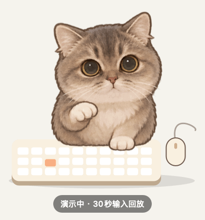

# MyCat 🐾

把你自己的猫变成 Q 版桌宠，陪你一起打字、点鼠标、摸鱼。默认使用主人授权公开分享的 Q 版猫素材，直接下载即可使用；不包含原始猫照片或 API Key。

**macOS 14+ · Apple Silicon / Intel · 原生 Swift / AppKit · 源码可自行编译**

仓库与下载包公开提供，无需邀请即可下载。默认猫形象根据作者本人猫照片经 AI 生成；不包含原始照片或 API Key。

[下载最新版](https://github.com/miaomeow12/MyCat/releases/latest/download/MyCat-macOS-universal.zip) · [所有版本](https://github.com/miaomeow12/MyCat/releases) · [隐私说明](docs/PRIVACY.md)



> 上图是通过真实动画路径回放的合成输入，明确标注“演示中”，不是录制用户的输入。应用里的完整演示持续 30 秒。

## 下载运行

1. [下载 MyCat-macOS-universal.zip](https://github.com/miaomeow12/MyCat/releases/latest/download/MyCat-macOS-universal.zip)，解压后把 **MyCat.app** 拖到“应用程序”。
2. 打开应用。单击猫右上角的 **菜单 ▾** 或菜单栏 **🐾**。
3. 开启 **键盘互动**，按提示前往 **系统设置 → 隐私与安全性 → 输入监控** 授权 MyCat。没有出现在列表时，可用 `+` 添加安装后的 MyCat.app。
4. 切回编辑器或聊天窗口打字，猫会交替抬爪、落爪；鼠标点击时，小鼠标会下压并显示点击反馈。

下载包使用 ad-hoc 签名，尚未通过 Apple 公证。其他 Mac 可能需要在“隐私与安全性”中允许打开。请只使用本仓库的下载或自行编译的版本。

## 它怎么陪你工作

- **打字**：真实 `keyDown` 事件触发完整拍键周期。连续输入合并成有节奏的左右爪动作，不逐事件闪烁；单次动作约 300 毫秒，抬爪/落爪均保持可读时间。
- **移动鼠标**：看向你指针所在的左、右或上方，小鼠标随移动反馈。
- **点击和长按鼠标**：真实鼠标按下/松开驱动小鼠标下压、变色、光圈；保持按下就保持状态。
- **摸猫和休息**：普通点击摸猫、拖动搬家；空闲 25 秒会睡觉，活动后醒来。
- **30 秒演示**：菜单可启动/停止，无需输入监控。前 20 秒连续打字，后 10 秒移动与点击鼠标；画面明确标注演示状态。
- **输入诊断**：显示监听是否连接，以及本次收到的按键、点击次数。只有内存计数，不记录按键内容。

Q 版目前使用 8 张动作图切换，加上呼吸、轻微位移和按键反馈，不是实时 3D 骨骼动画。连续输入会合并为可读动作，因此不会一比一按高速输入的次数闪爪。

## 换成你自己的猫

打开 **菜单 → 照片 → 生成我的 Q 版猫…**：

1. 选自己的猫照片，填写自己的 **OpenAI API Key**。
2. 点击 **上传并生成**，窗口显示 API 返回的流式草稿。
3. 生成完成后检查样子，点击 **应用为桌宠**。

每人使用自己的 API 额度，不需要运营中转服务器。Key 只在本次请求的内存中使用，不保存到磁盘。默认图像模型为 `gpt-image-2.5-flare`，可修改为账户有权限、支持透明 PNG 和编辑流式事件的模型。

生成不是瞬间完成，也不保证每次都严格遵守动作格子或完全还原花纹。应用会做尺寸、透明通道、分帧检查，应用前仍请查看预览。网络错误、额度不足或生成失败会保留原桌宠，不会自动重试付费请求。取消本机请求不保证撤销服务端已产生的费用。

也可用 **本地抠图** 或 **直接导入透明 PNG** 保留真实照片外观；这些操作不联网，但不会自动把照片分解成独立猫爪动作。切回 **Q 版外观** 可恢复当前动作猫。

## 隐私

日常陪伴可离线运行，无统计上报和自动更新：

- 键盘监听为只读 `listenOnly`，不读取键码、文字，不记录或发送输入。必须由你主动开启，并获系统输入监控授权；开关会记住你的选择。
- 鼠标仅读取当前指针位置和按下/松开事件，不改变真实指针，不保存轨迹。
- 只有点击“上传并生成”才向 `api.openai.com` 发送选中的照片和生成提示词。无内置共享 Key，无中转服务器。
- 自定义照片和动作图只存于 `~/Library/Application Support/MyCatLocal/`。

完整细节、数据清理和 API 验证范围见 [PRIVACY.md](docs/PRIVACY.md)。

## 不同步时检查什么

先打开 **输入诊断**，切回其他应用打字和点击，再查看计数：

- **按键计数不增长**：检查键盘互动是否开启、输入监控是否允许。移到“应用程序”后再授权；系统要求时退出重开。
- **计数增长但动作不明显**：运行 30 秒演示比较，确认正在使用 Q 版外观。原照片没有独立的抬爪动作。
- **鼠标不响应**：检查“跟着鼠标一起工作”是否打开。
- 密码框、安全输入和部分受保护场景可能暂时不提供键盘事件。应用不会绕过系统保护。

## 从源码构建

只依赖系统框架，需要 Apple Command Line Tools 或 Xcode：

```bash
xcode-select --install
git clone https://github.com/miaomeow12/MyCat.git
cd MyCat
./scripts/build.sh
open build/MyCat.app
```

生成 Intel + Apple Silicon 通用下载包：

```bash
./scripts/package.sh
# dist/MyCat-macOS-universal.zip
# dist/SHA256SUMS.txt
```

## 测试

```bash
./scripts/test.sh       # 无 GUI 的确定性输入模型测试
./scripts/test.sh --ui  # 需要 macOS 图形会话的完整回归，不请求真实输入权限或联网
```

回归包括 30 秒 / 300 次按下事件回放、最低可见姿态时间、24–120 Hz 时间一致性、鼠标长按/释放、多按钮、菜单入口、真实原生菜单弹出，以及完全本地模拟的流式图片生成。API 模拟测试不会消耗额度。应用内真实付费 API 生成尚未做端到端验证。

发布新版本：更新 `Resources/Info.plist` 和 `docs/RELEASE_NOTES.md`，推送 `v*` 标签；GitHub Actions 会测试、构建通用应用并创建附带校验和的 Release。

## 源码结构

| 文件 | 用途 |
| --- | --- |
| `Sources/MyCat/main.swift` | 桌宠窗口、真实输入监听、菜单及绘制 |
| `Sources/MyCat/InputMotion.swift` | 与帧率无关的抬爪/落爪和鼠标状态 |
| `Sources/MyCat/GenericCat.swift` | 无用户照片依赖的通用示例猫 |
| `Sources/MyCat/Companion.swift` | Q 版动作图读取与分帧 |
| `Sources/MyCat/Generation.swift` | 用户自带 Key 的 API 与流式生成窗口 |
| `Tests/main.swift` | 不需要 GUI 的输入节奏回归 |

项目受 [KeyCat](https://github.com/ElloboDK/KeyCat) 的陪伴交互启发，独立实现，未复制其源码或素材。默认加载 `Resources/personal-cat.png` 中主人授权的 Q 版动作图；自己的自定义动作图优先。无内置素材时回退到 `GenericCat.swift` 绘制的通用猫。原始猫照片不会随安装包分发。

## License

程序代码使用 [MIT](LICENSE)。猫咪动作图及衍生演示单独适用[图片素材使用说明](ASSET_LICENSE.md)，允许随本项目及其衍生版本使用和分发；请保留 AI 生成说明。
